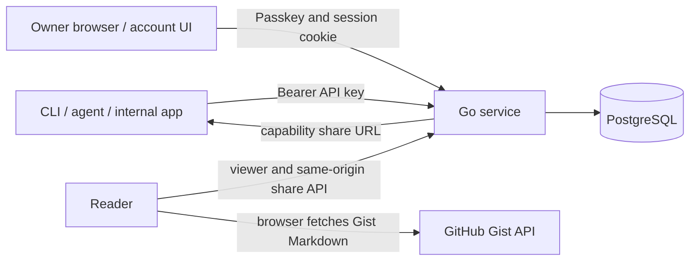
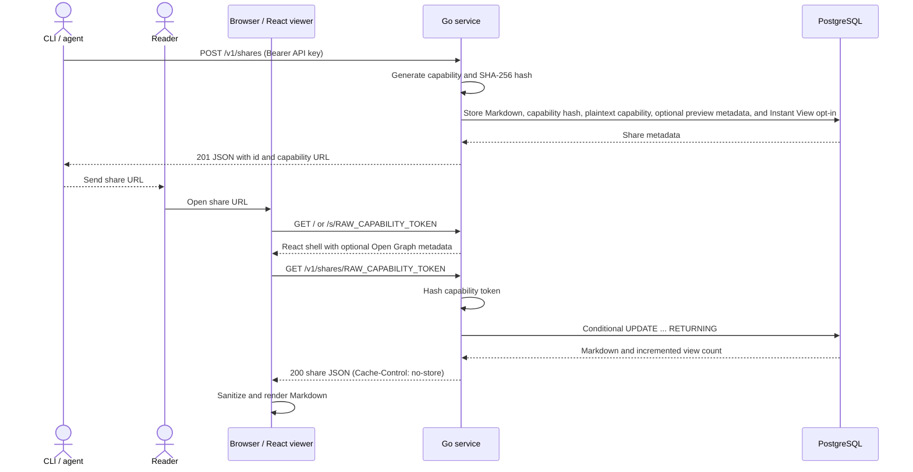

# Design and security

Morsel exposes the API and React viewer from one Go service on one domain. PostgreSQL is the only content store.

## How it works

The service handles `/`, `/example`, `/manage/shares`, `/manage/api-keys`, `/manage/invitations`, `/account`, `/login`, `/setup`, `/invite`, `/recover`, `/s/*`, `/gist/`, `/assets/*`, `/v1/*`, `/healthz`, and `/readyz` on one domain. Preview-enabled `/s/<token>` responses inject Open Graph metadata into the otherwise static viewer shell. Instant View shares additionally inject server-rendered GFM into the viewer root; the React viewer replaces it after loading in a browser. JavaScript and CSS remain static assets. Morsel has no Redis, object storage, queue, separate static host, or Node.js runtime server.

## Account and authentication boundaries

- Setup creates an `admin` with a single-use operator token. Migration 12 promotes the oldest existing account ordered by `created_at, id`; the rest become `user`. Empty databases remain empty until setup. Roles are constrained to `admin` and `user` with default `user`; startup/login never reassign them. All invitations, including operator invitations, create users explicitly. No client role choice, role editing, invitations that create admins, user directory, ownership transfer, or account deletion is provided. Neither role grants access to another account's shares or management data. Database and backup operators remain trusted.
- Admin browsers can issue invitation links at `POST /v1/account/invitations`; operator CLI grants remain compatible. Grants expire after one hour, are independent and single-use, and retain only hashes in PostgreSQL. Invitation completion creates the user account, first credential, and session in one transaction. No email delivery, SMTP, email binding, or person verification is provided. Admins manually share forwardable bearer links. There is no invitation listing or revocation; issuing-admin logout/recovery does not invalidate a link.
- `/setup`, `/invite`, `/login`, and `/recover` provide separate authentication pages; `/account` manages backup credentials. Account display names are nonempty, bounded to 200 UTF-8 bytes, and need not be unique. Passkey names are separate. The stable account UUID remains the WebAuthn user handle; existing passkeys remain valid. `/manage/shares` provides share search, administrative content inspection, and revocation; `/manage/api-keys` provides key management. Admin-only `/manage/invitations` provides invitation creation. Ordinary users do not see its navigation entry; direct visits show access denied, and the API enforces the role independently. The account menu provides logout. Registration and login require discoverable credentials and user verification. The last passkey cannot be removed.
- The RP ID is the hostname from `MORSEL_URL`; the allowed origin includes its scheme and port. Production uses RP ID `morsel.narumi.dev` and origin `https://morsel.narumi.dev`, derived from configuration rather than request headers. Local Vite development uses RP ID `localhost` and exact origin `http://localhost:5173`.
- Browser sessions alone can manage passkeys and API keys. Cookie-authenticated mutations require exact Origin checks and session-bound CSRF tokens. Existing `/v1/shares` writes remain Bearer-only; session cookies do not authorize them. Separate `/v1/account/shares` routes require a session and permit inspection and revocation only of that session's account-owned shares. API keys alone cannot access these routes. Public capability reads remain unchanged.
- PostgreSQL stores credential records and hashes of opaque session tokens. Production cookies are host-only, `Secure`, `HttpOnly`, and `SameSite=Lax`. Non-Secure cookies are permitted only for supported localhost HTTP development.
- Setup, invitation, and recovery grants expire after one hour, WebAuthn flows after 10 minutes, and sessions after 30 days without sliding renewal. Session cookies persist across browser restarts. Key creation, revocation, invitation issuance, and passkey changes reuse passkey verification for 12 hours; the UI checks current server state before each change, and the server rechecks authorization in the completion transaction. Authentication and management responses use `Cache-Control: no-store`.
- Recovery requires an operator grant targeted to an explicit account UUID. Replacement grants cancel earlier recovery grants for that account only. Recovery replaces that account's credentials and advances its authentication generation. Completion invalidates its old sessions, bound flows, and verification/recovery grants; other accounts are unaffected. Account mutations recheck generation and authorization under the account lock, so old in-flight authorization cannot commit after recovery. Recovery preserves the account role and does not revoke API keys; review them separately.
- API keys contain at least 256 random bits. Only a SHA-256 hash and metadata are stored; the raw key is shown once at creation. Each privileged request checks active key state in PostgreSQL, without an authentication cache. Database errors fail closed.
- All active API keys in one account have the same share permissions. Creation obtains ownership from the validated key's typed internal principal, never from a body, query, or request header. Each share has a NOT NULL account foreign key with restrictive deletion. Every management operation requires an explicit account; there is no unscoped fallback. Browser and Bearer revocation include ownership in the UPDATE predicate. Foreign and missing share UUIDs return the same `404 not_found`, while repeated revocation of an owned share succeeds. Key revocation blocks subsequent requests but does not cancel an already-authorized operation or revoke shares. Existing environment-configured keys are not supported after cutover; client-side `MORSEL_API_KEY` remains supported for UI-created keys.

Discoverable login begins without selecting an account. Only login flows may have NULL account and generation fields. The assertion's credential ID and user handle must resolve to the same registered account; unknown and mismatched pairs use the same public failure. Under the account lock, the pinned WebAuthn library verifies the assertion against current credentials. The PostgreSQL `auth_event_order` sequence uses `CACHE 1` and `NO CYCLE` for credential `registered_order` and flow `started_order`. Login requires `registered_order < started_order`; equal or backwards wall-clock timestamps cannot authorize a later credential. A new passkey or recovery replacement needs a new login flow. Recovery does not reset this sequence or cancel other accounts' unbound login flows. Verification and passkey changes remain session-, account-, and generation-bound with locks held through commit.

Successful authenticated browser management and bound authentication responses use a server-derived `X-Morsel-Account-ID` marker, including key/passkey operations, share links and capability verification, verification/passkey begin and finish, and logout. `/v1/account` returns `account_id`, `display_name`, and `role` only when authenticated. Invitation creation also carries the authorized account marker; it does not add a marker to Bearer share writes. Unauthenticated account-state responses, errors, and Bearer share-write responses need no browser identity marker. Public capability responses never include it. No request-side owner selector or account enumeration is provided. The UI checks the response marker against the expected and current identities before using private data. Missing or mismatched markers discard data and refresh identity; mutations are not replayed. Secret-free `BroadcastChannel` events and focus/visibility refreshes invalidate stale private state, saved links, confirmations, one-time keys, and invitation links. These checks supplement server authorization and CSRF, not replace them.

### Invitation authorization and token lifecycle

`POST /v1/account/invitations` accepts only an empty JSON object and no query parameters. A valid browser session, exact configured Origin, session-bound CSRF, fresh verification, and database role `admin` are required. The role is loaded under the account lock; authorization, role checking, and grant insertion share a transaction with locks held through commit. Missing or unknown roles never authorize issuance. API keys alone, including admin-owned keys, cannot invite. Recovery/logout or permission loss before authorization completes prevents issuance. The existing limiter uses a fixed issuance bucket; 429 includes `Retry-After` and inserts no grant. Existing request-size limits apply.

Success returns `201` with `invitation_url`, database-derived `expires_at`, `Cache-Control: no-store`, and `X-Morsel-Account-ID`. The URL uses only the configured origin and `/invite#token=<43-character base64url token>`, never Host/forwarded headers. Common grant insertion preserves the operator `IssueGrant` signature and raw-token CLI output. It does not add plaintext grant records or change existing valid grants.

The invitation fragment is the only grant-token URL exception. Setup and recovery remain form-only. No grant secret is supported in a query or path; no token-bearing GET validation or automatic registration is added. The viewer extracts exactly one unescaped, canonical 43-character base64url token before authentication redirects or shared navigation state, rejects malformed encoding and duplicate/unknown fields, and immediately replaces the current entry with clean `/invite`. Back, Forward, rerenders, and route changes cannot restore it from shared state. Tokens never enter `history.state`, `next`, browser storage, telemetry, or automatic clipboard writes. They remain in invitation-flow memory, prefill **Invitation token**, and are submitted only in the existing registration POST body after explicit **Create account** with **Account name** and **Passkey name**. Submission, success, unmount, and account changes clear the in-memory token. Reload or cancellation can require reopening the original link; cancellation does not consume the grant.

A signed-in recipient is not silently registered or switched. The viewer clears the fragment and instructs logout/private-window use followed by reopening the original link; it does not persist the invitation across logout. The backend checks for a valid signed-in session at both invite begin and finish, returning `409 sign_out_required` without consuming the grant or overwriting the session. Expired/invalid cookies can proceed; database errors fail closed. Invalid, expired, used, or concurrently redeemed grants retain the generic invalid-grant failure. Page fetches and previews do not consume grants.

The admin UI displays one link at a time, requires **Dismiss invitation link** before another creation, and warns before discarding an undismissed link. Section exit, logout, identity change, permission loss, or obsolete responses clear link state. Response-marker, role, and current-identity checks discard obsolete responses and run immediately before clipboard invocation; copy success is reported only after completion while authorization remains current. A native write already started while authorized cannot be cancelled. Late acknowledgements do not report success or start another write. Mutations are never automatically replayed; explicit retry creates an independent link. Fragment cleanup cannot remove external message/preview copies, URL rewriting, or browser history copies made before cleanup. Virtual browser tests do not establish real messaging or physical passkey behavior.

## View and availability semantics

- Every successful `GET /v1/shares/<token>` consumes exactly one view, including browser refreshes, command-line requests, and bots that call the API.
- Fetching an enabled `/s/<token>` Open Graph preview does not consume a view. Link-preview crawlers do not execute the viewer JavaScript, while a browser does and therefore consumes a view through the API.
- An Instant View share exposes the complete rendered article through the same non-consuming request. It cannot use expiration or view limits, and revocation cannot remove copies already cached by Telegram.
- Preview metadata can be fetched repeatedly by anyone holding its capability URL. Disable preview when its explicit title, description, image URL, or locale must not be exposed this way.
- Morsel does not identify people or deduplicate clients. `max_views` counts successful retrievals, not unique readers.
- A conditional PostgreSQL `UPDATE ... RETURNING` protects the final view, so concurrent requests cannot exceed the configured limit.
- Retrieval responses use `Cache-Control: no-store`; proxies must not cache them.
- Unknown capabilities return `404`. Expired, revoked, and exhausted capabilities return `410` with distinct codes. This improves viewer messages but reveals the capability's state to anyone who already possesses it.
- Owner-only administrative list and detail requests do not consume views. Administrative Markdown renders image placeholders and inert Mermaid source, because both Markdown images and Mermaid image nodes can request a consuming share endpoint before sanitation. Public rendering is unchanged. Detail requests expose stored content even after expiration, view exhaustion, or revocation; these states limit public access, not owner access. Management responses use `Cache-Control: no-store`, and the UI clears private state after logout, an authentication failure, or an account change. Revocation requires Origin, CSRF, and passkey verification within twelve hours. Authorization locks remain held through the revocation commit, including account generation checks that serialize against recovery.
- Management status uses database time with precedence revoked, expired, view-limit-exhausted, then active. Cursor pages support `newest`/`oldest` creation order and `most_views`/`least_views` view-count order. View-count ties use creation time, then UUID. All keys use the same direction: descending for `newest` and `most_views`, ascending for `oldest` and `least_views`. The account predicate applies before search, status, counts, cursor filtering, ordering, and limits. Search is a literal case-insensitive substring of the displayed label; count and page use one database statement and snapshot. Version 3 cursors bind account, status, normalized search fingerprint, and sort. View-sort cursors also carry the last row's nonnegative integer view count; missing or invalid counts are rejected. Foreign-account and unbound v1/v2 cursors return 400; restart at page one. SQL enforces ownership independently of cursor contents. Pages are live queries, not a snapshot across requests. Public reads can change counts and status between pages, so view-sorted rows can cross a cursor and be skipped or repeated. Restart from the first page to refresh the order. View sorting requires no schema migration.
- New shares retain plaintext capability tokens in `link_token`; no share-link encryption key is required. Retrieval checks the token against the stored capability hash. Owner-session GET requests retrieve canonical URLs under the same account/session transaction locks as administrative detail reads, without consuming a view or changing availability. Responses use `Cache-Control: no-store`; list/detail metadata includes only `link_available`, not capability data. An owned row with a NULL token returns `404 link_unavailable`; foreign and missing rows return the same `404 not_found`. Invalid or mismatched tokens fail closed with a generic service error.
- Copy link writes directly to the clipboard and reports success only after completion. Show link and clipboard failure expose a selectable field inline, not a dialog. The UI holds URLs only in section memory until unmount, logout, session loss, or account change. The compatibility owner-only POST can still verify an owner-supplied capability with exact Origin and CSRF, without retaining it. No route regenerates an existing capability.

## Administrative labels

Creation derives a bounded plain-text `admin_label` from the existing preview title or a Goldmark-parsed source line. Explicit preview titles remain plain text as authored. Source-derived labels retain code and link text but omit formatting, destinations, and authored HTML. Stored source, public preview metadata, capability hashes, limits, and counts are unchanged.

Migration 8 adds nullable label metadata and a partial pending-label index. The migration executable fills pending labels in bounded loops of 16 documents, reading and committing each document separately, outside account/session locks. NULL labels form a resumable work list. Rerunning migration up completes unfinished work without rewriting completed labels. Reads do not parse all documents: list/count queries use stored labels and return `503 label_backfill_required` if any labels in the current account remain pending, including zero-match searches. Detail reads return that error only for an owned pending target; foreign targets return 404 first. Public capability access does not depend on label readiness.

## Security model

- Capability tokens contain 256 random bits and are base64url encoded. PostgreSQL stores their SHA-256 hashes for public authorization and plaintext tokens for new shares so the owner can retrieve saved links. Database or backup access exposes retained capabilities and Markdown content. Protect both as secrets. Owner authentication restricts API access; it does not protect against direct database access. Legacy hashes cannot be reversed.
- Preview is disabled when its metadata object is omitted. Hash-route URLs keep the capability out of the initial document request; preview metadata intentionally places it in `/s/<token>` so link crawlers can request the explicit title, description, optional image and locale, and canonical share URL.
- Telegram Instant View is separately disabled by default. Enabling it exposes sanitized rendered Markdown in the initial HTML and permits Telegram to retain a cached copy outside Morsel's revocation controls.
- Authentication attempts have rate and request-size limits. WebAuthn verification uses a maintained library; expiring flows are browser-bound, operation-bound, and single-use.
- Request logs use route templates instead of token-bearing paths and omit bodies, authorization headers, cookies, operator tokens, WebAuthn payloads, and raw API keys.
- Authored HTML is disabled. Markdown from both Morsel shares and GitHub Gists passes through the same reviewed sanitation schema; KaTeX output is sanitized as well.
- Homepage URL validation accepts only known same-origin share/Gist viewer routes and exact HTTPS GitHub Gist routes. It performs no validation fetch, stores no pasted URL, and preserves fragment share routing. The bundled example needs no network API. The shared public header makes no account-state request.
- Management navigation aborts obsolete reads and ceremonies. One-time keys remain in memory only; navigation warns before discarding an undismissed key. Section destinations are fixed internal routes, not arbitrary return URLs.
- Gist IDs are validated before the browser makes an unauthenticated request to the CSP-allowlisted `api.github.com` origin.
- KaTeX trust is disabled. Mermaid renders sequentially with strict security, source and count limits, and DOMPurify SVG sanitation.
- Vega-Lite uses interpreted expressions, inline-only resources, rejected expansive generators and transforms, disabled embed options and tooltips, and source and count limits.
- External links use `noopener noreferrer`; images use `Referrer-Policy: no-referrer` and lazy loading.
- Production serves the API and viewer from one HTTPS origin and does not enable browser CORS.

Public capability reads, previews, Instant View, and state diagnostics remain token-based and contain no account IDs or display names. Anyone with a valid capability can read, including a user signed in to another account. Morsel cannot protect a share after its capability URL is disclosed. Revoke exposed shares and rotate exposed administrative keys.
