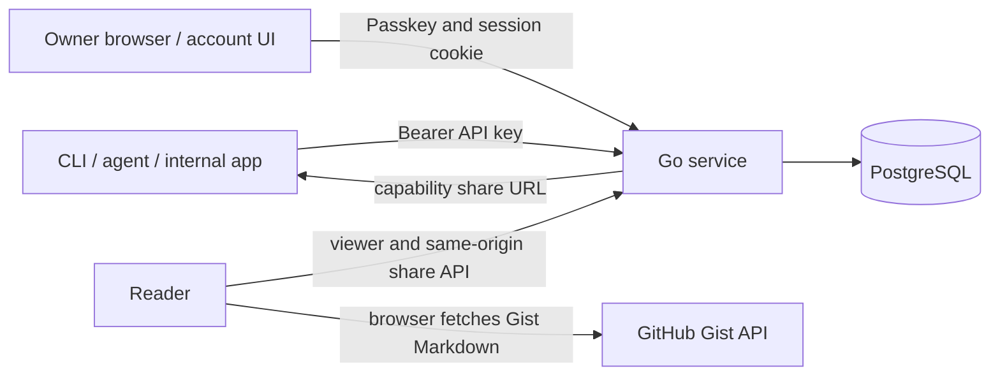
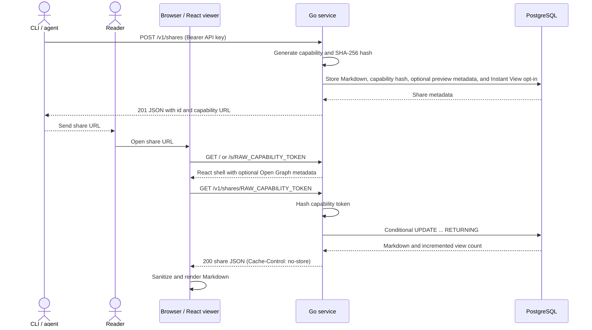

# Design and security

Morsel exposes the API and React viewer from one Go service on one domain. PostgreSQL is the only content store.

## How it works

The service handles `/`, `/account`, `/s/*`, `/gist/`, `/assets/*`, `/v1/*`, `/healthz`, and `/readyz` on one domain. Preview-enabled `/s/<token>` responses inject Open Graph metadata into the otherwise static viewer shell. Instant View shares additionally inject server-rendered GFM into the viewer root; the React viewer replaces it after loading in a browser. JavaScript and CSS remain static assets. Morsel has no Redis, object storage, queue, separate static host, or Node.js runtime server.

## Account and authentication boundaries

- Only the first account can register, with a single-use operator setup token. Registration is serialized in PostgreSQL; later account creation is rejected by the API. Invitations are not implemented.
- `/account` supports passkey setup, login, backup credentials, API key management, share history, administrative content inspection, share revocation, and logout. Registration and login require discoverable credentials and user verification. The last passkey cannot be removed.
- The RP ID is the hostname from `MORSEL_URL`; the allowed origin includes its scheme and port. Production uses RP ID `morsel.narumi.dev` and origin `https://morsel.narumi.dev`, derived from configuration rather than request headers. Local Vite development uses RP ID `localhost` and exact origin `http://localhost:5173`.
- Browser sessions alone can manage passkeys and API keys. Cookie-authenticated mutations require exact Origin checks and session-bound CSRF tokens. Existing `/v1/shares` writes remain Bearer-only; session cookies do not authorize them. Separate `/v1/account/shares` routes require an owner session and permit inspection and revocation of all shares, including rows created before account setup. API keys alone cannot access these routes. Public capability reads remain unchanged.
- PostgreSQL stores credential records and hashes of opaque session tokens. Production cookies are host-only, `Secure`, `HttpOnly`, and `SameSite=Lax`. Non-Secure cookies are permitted only for supported localhost HTTP development.
- Setup and recovery grants expire after one hour, WebAuthn flows after 10 minutes, and sessions after 30 days without sliding renewal. Session cookies persist across browser restarts. Key creation, revocation, and passkey changes reuse passkey verification for 12 hours; the UI checks current server state before each change, and the server rechecks authorization in the completion transaction. Authentication and management responses use `Cache-Control: no-store`.
- Recovery replaces credentials and advances the account authentication generation. Completion invalidates old sessions, pending flows, and verification/recovery grants. Account mutations recheck generation and authorization under the account lock, so old in-flight authorization cannot commit after recovery. Recovery does not revoke API keys; review them separately.
- API keys contain at least 256 random bits. Only a SHA-256 hash and metadata are stored; the raw key is shown once at creation. Each privileged request checks active key state in PostgreSQL, without an authentication cache. Database errors fail closed.
- All owner-issued API keys retain administrator rights, including revocation of any existing share. Key revocation blocks subsequent requests but does not cancel an already-authorized operation or revoke shares. Existing environment-configured keys are not supported after cutover; client-side `MORSEL_API_KEY` remains supported for UI-created keys.

## View and availability semantics

- Every successful `GET /v1/shares/<token>` consumes exactly one view, including browser refreshes, command-line requests, and bots that call the API.
- Fetching an enabled `/s/<token>` Open Graph preview does not consume a view. Link-preview crawlers do not execute the viewer JavaScript, while a browser does and therefore consumes a view through the API.
- An Instant View share exposes the complete rendered article through the same non-consuming request. It cannot use expiration or view limits, and revocation cannot remove copies already cached by Telegram.
- Preview metadata can be fetched repeatedly by anyone holding its capability URL. Disable preview when its explicit title, description, image URL, or locale must not be exposed this way.
- Morsel does not identify people or deduplicate clients. `max_views` counts successful retrievals, not unique readers.
- A conditional PostgreSQL `UPDATE ... RETURNING` protects the final view, so concurrent requests cannot exceed the configured limit.
- Retrieval responses use `Cache-Control: no-store`; proxies must not cache them.
- Unknown capabilities return `404`. Expired, revoked, and exhausted capabilities return `410` with distinct codes. This improves viewer messages but reveals the capability's state to anyone who already possesses it.
- Owner-only administrative list and detail requests do not consume views. Administrative Markdown renders image placeholders and inert Mermaid source, because both Markdown images and Mermaid image nodes can request a consuming share endpoint before sanitation. Public rendering is unchanged. Detail requests expose stored content even after expiration, view exhaustion, or revocation; these states limit public access, not owner access. Management responses use `Cache-Control: no-store`, and the UI clears private state after logout or an authentication failure. Revocation requires Origin, CSRF, and passkey verification within twelve hours. Authorization locks remain held through the revocation commit, including account generation checks that serialize against recovery.
- Management status uses database time with precedence revoked, expired, view-limit-exhausted, then active. Cursor pages use descending creation time and UUID; they are live queries, not a snapshot across requests.
- A lost raw capability cannot be recovered. Revoke the share and create a replacement. The management UI does not store raw capabilities or offer public URL recovery.

## Security model

- Capability tokens contain 256 random bits, are base64url encoded, and are never stored raw.
- Preview is disabled when its metadata object is omitted. Hash-route URLs keep the capability out of the initial document request; preview metadata intentionally places it in `/s/<token>` so link crawlers can request the explicit title, description, optional image and locale, and canonical share URL.
- Telegram Instant View is separately disabled by default. Enabling it exposes sanitized rendered Markdown in the initial HTML and permits Telegram to retain a cached copy outside Morsel's revocation controls.
- Authentication attempts have rate and request-size limits. WebAuthn verification uses a maintained library; expiring flows are browser-bound, operation-bound, and single-use.
- Request logs use route templates instead of token-bearing paths and omit bodies, authorization headers, cookies, operator tokens, WebAuthn payloads, and raw API keys.
- Authored HTML is disabled. Markdown from both Morsel shares and GitHub Gists passes through the same reviewed sanitation schema; KaTeX output is sanitized as well.
- Gist IDs are validated before the browser makes an unauthenticated request to the CSP-allowlisted `api.github.com` origin.
- KaTeX trust is disabled. Mermaid renders sequentially with strict security, source and count limits, and DOMPurify SVG sanitation.
- Vega-Lite uses interpreted expressions, inline-only resources, rejected expansive generators and transforms, disabled embed options and tooltips, and source and count limits.
- External links use `noopener noreferrer`; images use `Referrer-Policy: no-referrer` and lazy loading.
- Production serves the API and viewer from one HTTPS origin and does not enable browser CORS.

Morsel cannot protect a share after its capability URL is disclosed. Revoke exposed shares and rotate exposed administrative keys.
