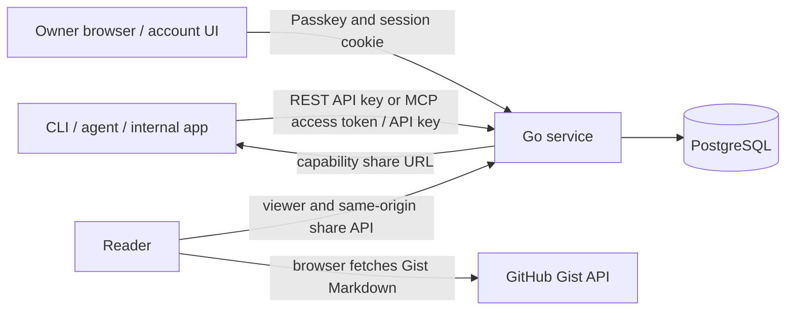
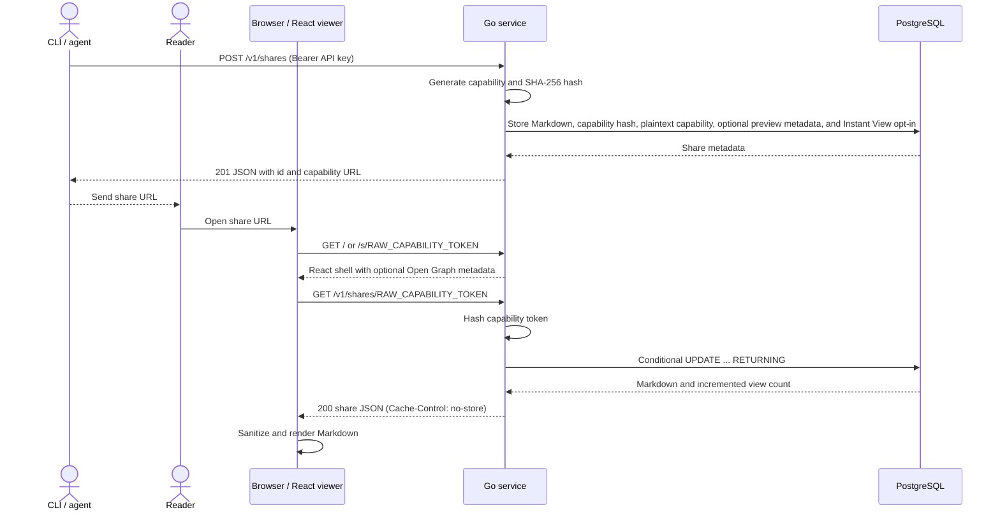
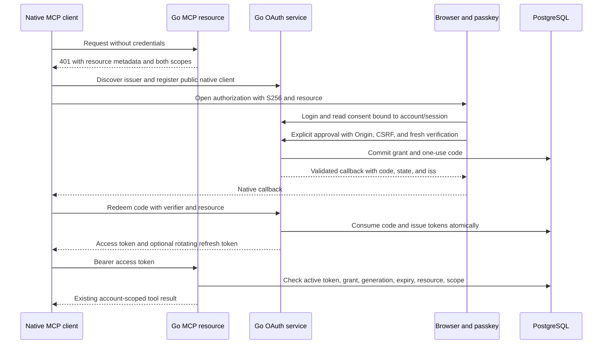

# Design and security

Morsel exposes the API and React viewer from one Go service on one domain. PostgreSQL is the only content store.

## How it works

The service handles `/`, `/example`, `/manage/shares`, `/manage/api-keys`, `/manage/invitations`, `/account`, `/login`, `/setup`, `/invite`, `/recover`, `/oauth/consent`, `/s/*`, `/gist/`, `/assets/*`, `/v1/*`, `/mcp`, explicit OAuth protocol and well-known routes, `/healthz`, and `/readyz` on one domain. Preview-enabled `/s/<token>` responses inject Open Graph metadata into the otherwise static viewer shell. Instant View shares additionally inject server-rendered GFM into the viewer root; the React viewer replaces it after loading in a browser. JavaScript and CSS remain static assets. Morsel has no Redis, object storage, queue, separate static host, or Node.js runtime server.

## MCP transport and tool boundary

`/mcp` uses the official Go MCP SDK pinned to v1.8.0 with stateless Streamable HTTP and JSON responses. Supported and tested protocol versions are `2025-11-25`, `2025-06-18`, and `2025-03-26`. The SDK handles initialization, notifications, `ping`, discovery, and tool dispatch. There are no persistent sessions, session IDs, persistent SSE streams, replay storage, or legacy HTTP+SSE transport. The `2025-03-26` protocol also accepts JSON-RPC batches; calls within one HTTP request run in sequence so request metadata remains safe. Later protocol versions reject batches. Authenticated GET and DELETE return `405` with `Allow: POST`; `/mcp` never falls through to viewer HTML.

Every request, including initialization and discovery, validates either an OAuth access token or an existing UI-managed Bearer API key against PostgreSQL and derives the same request-local typed account principal. No identity is retained in an MCP session or authentication cache. Cookies, codes, and refresh tokens cannot authorize MCP. Missing or invalid credentials return HTTP `401` with the Bearer challenge, canonical `resource_metadata`, and `scope="mcp:shares offline_access"`. Otherwise valid access tokens without share permission return HTTP `403` with `insufficient_scope`. Authentication database failures return safe HTTP `503`, without running a tool or falling back to a different credential type.

The handler checks authority/Host against `MORSEL_URL`, normalizing hostname case and default ports. This configured-host check provides DNS rebinding protection when the SDK's loopback-only Host protection is disabled for reverse-proxy use. Forwarded headers do not select the allowed host or origin. An omitted Origin is allowed; a present Origin must be one exact canonical configured origin. Duplicate, `null`, invalid, and foreign Origins fail with `403`. MCP CORS remains disabled. Public OAuth metadata alone permits credential-free GET/OPTIONS CORS. POST requires JSON Content-Type and Accept support for both `application/json` and `text/event-stream`; subsequent requests carry the negotiated `MCP-Protocol-Version`.

The adapters call existing `Service.CreateShare`, `Service.ConsumeShare`, and `Service.RevokeShare` operations, without internal HTTP calls or separate share rules:

- `create_share` accepts all REST creation fields: `content`, `expires_in`, `max_views`, `preview`, and `telegram_instant_view`. Optional expiration/view-limit nulls mean absent. Ownership comes only from the validated credential's account. Creation is not idempotent.
- `get_share` accepts a raw capability `token`, not a URL or administrative UUID. Each success consumes one view; it is neither read-only nor idempotent. A valid capability can read another account's share without returning owner identity.
- `revoke_share` accepts an administrative UUID `id` and only revokes shares owned by the validated credential's account. Success is `{ "id": "...", "revoked": true }`. It is destructive and idempotent; foreign and missing targets have the same `not_found` result.

`tools/list` exposes explicit input and output schemas with unknown-field rejection. Typed decoding preserves int64 limits. Results contain structured JSON and the same JSON as text. Safe tool failures use `isError: true` with existing `code` and `message` fields, not REST HTTP statuses. Protocol failures use SDK JSON-RPC or HTTP validation errors; malformed and unregistered legacy requests can return HTTP `400`. Expired, revoked, and exhausted capability errors remain distinct. OpenAPI documents REST and manual OAuth/account routes, not MCP tool schemas. Its generator still includes only the existing health/share operations. MCP adds no account, listing, or admin tools and does not broaden REST or browser authorization.

Existing body/document limits, request deadlines, security headers, and secret-free route logging apply. The adapter restores the original HTTP deadline and cancellation because the SDK detaches them. A deadline that ends before response commitment returns safe HTTP `504`. The response writer enforces `Cache-Control: no-store` at header commitment, including failures; SDK payload logging is not enabled. Never retrieve a newly created share to validate it, fetch arbitrary URLs, or automatically retry creation or retrieval. A lost response does not prove the operation failed.

## Native MCP OAuth

The authorization server and MCP resource server run in the same Go process. Fosite v0.49.0 supplies only authorization-code, refresh, and PKCE handlers. Its release cadence is slow; retain explicit dependency pins and the full vulnerability gate. Its pinned dependency set includes patched go-jose/v3 v3.0.5, x/net v0.62.0, gRPC v1.83.2, and OpenTelemetry SDK/OTLP exporters v1.45.0; dependency and vulnerability gates remain required. A custom CoreStrategy generates independent 256-bit opaque authorization codes (`moc_`), access tokens (`moa_`), and refresh tokens (`mor_`). It uses SHA-256 signatures of complete type-separated credentials for database lookup. It does not use a signing/HMAC secret, JWT signing keys, or an external identity provider. No new secret configuration is required.

### Discovery and client profile

- The issuer is the canonical `MORSEL_URL` origin; the sole resource is `<origin>/mcp`. Metadata, callback `iss`, and persisted issuer/resource bindings use configuration, never request Host or forwarded headers. Public RFC 9728 and RFC 8414 metadata are at `/.well-known/oauth-protected-resource/mcp` and `/.well-known/oauth-authorization-server`.
- `/oauth/authorize`, `/oauth/token`, `/oauth/register`, and `/oauth/revoke` are protocol handlers, separate from browser-cookie JSON handlers. They use bounded single-valued parameters, strict methods/content types, no-store responses, safe errors, and a separate OAuth limiter. Cookies add no protocol authority. An absent Origin is allowed for native requests; a supplied Origin must be one exact configured origin. There is no application-wide CORS.
- DCR supports public native clients with `token_endpoint_auth_method=none`. It issues no client secret or registration-management token. Client names are unverified display text. CIMD is deliberately omitted despite the MCP recommendation: client-controlled metadata fetching adds an SSRF surface. No client URL, logo, metadata document, or callback target is fetched by Morsel.
- Only authorization code with `S256` PKCE and rotating refresh tokens is supported. Authorization binds client ID, validated redirect, bounded `state`, challenge, scope, and RFC 8707 resource. Exchange requires that client, the exact authorized redirect, verifier, and resource. RFC 9207 `iss` is advertised and returned with both code and denial. Invalid authorization input produces a local safe error, not an unvalidated error redirect.
- Redirect matching is exact, except that HTTP IP-literal loopback callbacks (`127.0.0.1` or `[::1]`) may change only the port. Scheme, host, path, and remaining URI bytes stay fixed. HTTP `localhost` and HTTPS callbacks require exact matching. Wildcards, prefixes, userinfo, queries, fragments, and escaped paths are rejected before any callback can be returned.
- `mcp:shares` permits the existing three tools only. Optional `offline_access` permits refresh, not additional share/account operations. The initial MCP challenge includes both scopes because Pi uses challenge scope instead of resource-metadata scopes; a URL-only Pi connection therefore receives refresh capability. Refresh cannot change resource. When supplied, refresh `scope` must equal the granted canonical scope after order normalization; narrowing and widening both return `invalid_scope`, not silently ignored scope. Downscoping is not implemented; authorize a new request without `offline_access` for no refresh. Actual Pi and the configured Go integration omit scope on refresh.
- OAuth verification exists only at `/mcp`. REST Bearer writes still use the API-key authenticator. OAuth cannot manage accounts, sessions, passkeys, keys, invitations, or connected apps. Legacy API keys keep their non-expiring lifetime until explicit revocation, REST/MCP permissions, and unchanged recovery behavior.

### Persistent state and credential lifecycle

Migration 13 adds only `oauth_clients`, `oauth_requests`, `oauth_grants`, and `oauth_tokens`. PostgreSQL stores credential signatures/hashes, client metadata, bounded protocol state, PKCE challenge, and account/generation/resource bindings. Raw codes, access/refresh tokens, request handles, and PKCE verifiers are not stored. Pending requests retain bounded client `state` until completion or expiry. Hash-only OAuth storage does **not** make database backups non-secret: existing share rows still contain raw share capabilities and Markdown.

| State | Deadline |
| --- | --- |
| Pending request | 10 minutes |
| One-use code | 1 minute |
| Access token | 10 minutes, capped by family expiry |
| Offline-access family / refresh token | 30 days absolute from approval; rotation never extends it |
| Access-only family | 10 minutes from approval; no refresh token |

Database `clock_timestamp()` supplies authoritative protocol expiry. The application holds an outer transaction and locks account before grant/session/request rows. Fosite cannot commit that transaction. Approval, code consumption, PKCE-state deletion, token issuance, refresh rotation, replay revocation, and recovery serialize through these locks. An unsuccessful issuance rolls back all changes; a detected replay commits family revocation. Consumed code/refresh tombstones remain for active-family replay detection, including after a process restart. Rotation invalidates previous access credentials as well as the consumed refresh token. A concurrent redemption may first succeed and then lose its family when the second request detects reuse. No redemption is idempotent. Lost code/token responses are uncertain; do not automatically retry them or MCP mutations.

Every MCP HTTP request checks token type/shape, active token, finite token and family expiry, grant revocation, account generation, configured issuer provenance, exact resource, and share scope before constructing the private API principal. Revocation stops subsequent requests, not already-authorized in-flight share operations. PostgreSQL state survives restart and is shared across processes. No JWT trust cache or session-ID identity retention is added.

### Consent, connected apps, and recovery

The viewer serves only the exact `/oauth/consent?request=<bounded opaque handle>` continuation. Login/navigation validation does not accept arbitrary external `next` destinations. GET can bind a pending request to the displayed account, generation, and exact session; it never issues a grant or code. Approval without that read is rejected. The UI shows account name/UUID, unverified client name/ID, redirect host, resource, share permissions, and persistent access. It explains that each capability read consumes a view and that the app cannot manage the account.

Approval rechecks exact Origin, CSRF, session, account ID, generation, twelve-hour verification freshness, request expiry, and single-use state under lock through commit. Denial requires the same browser authorization except freshness and issues no credentials. Account switching, logout, recovery, stale responses, and even a new session for the same account require a new request. Normal logout invalidates pending session-bound consent, not previously issued grants or API keys. Successful private consent/grant responses use no-store and the server-derived `X-Morsel-Account-ID` marker. The viewer clears stale state and does not replay decisions, including across tabs.

`/account` lists only the signed-in account's connected-app families. Browser-only routes inspect consent and grants and revoke one owned family; revocation requires exact Origin, CSRF, and fresh verification. Foreign and missing grant UUIDs have the same 404 response. Names are not ownership selectors. Revoking a connection does not revoke another family, remove shares, or revoke API keys. Tokens/verifiers never enter browser storage, shared navigation events, `next`, history state, or telemetry. Codes necessarily enter the validated native callback; they remain one-use, short-lived, PKCE-bound, and excluded from logs/referrers.

Targeted account recovery advances `auth_generation`, invalidating all older OAuth codes, grants, and tokens in addition to old passkeys, browser sessions, and bound authentication state. It does not revoke API keys, change roles, or affect other accounts. A backup restore can revive OAuth state; [operations](deployment.md#oauth-upgrade-rollback-and-restore) require invalidating restored families and deleting pending requests before startup.

### Admission and cleanup

Protocol bodies/authorization parameters are bounded to 16 KiB; each parameter is at most 2,048 bytes. Registration permits one to five validated redirect URIs and a trimmed name of 1–200 UTF-8 bytes. Client registrations expire after ninety days, extended by valid authorization/token traffic.

All retained rows count toward caps: 10,000 clients, 10,000 requests, 10,000 grants, 100 grants per account, and 10,000 token rows per family. Admission uses a shared database lock; a family's token insertion is transactionally bounded under its grant lock. Revoked or expired rows count until eligible cleanup removes them. Cleanup runs on protocol traffic at most once per minute per process, deleting at most 2,000 rows per statement. It removes expired requests, expired access rows, and tokens in expired/revoked families. Code/refresh tombstones for active families survive until family expiry. Grants remain until expiry and token removal; clients remain until expiry with no retained grant/request references. Revocation alone does not free a grant slot. At a cap, wait for eligible expiry/cleanup, then explicitly reauthorize; never automatically retry issuance/refresh.

The OAuth limiter is separate from browser authentication limits: 60 requests per source IP and fixed endpoint kind per minute, with 1,000 requests per minute across that process's OAuth limiter. Forwarded IP headers are not trusted; clients behind one proxy share source-IP limits. No new limiter configuration or outbound fetch service is added.

## Account and authentication boundaries

- Setup creates an `admin` with a single-use operator token. Migration 12 promotes the oldest existing account ordered by `created_at, id`; the rest become `user`. Empty databases remain empty until setup. Roles are constrained to `admin` and `user` with default `user`; startup/login never reassign them. All invitations, including operator invitations, create users explicitly. No client role choice, role editing, invitations that create admins, user directory, ownership transfer, or account deletion is provided. Neither role grants access to another account's shares or management data. Database and backup operators remain trusted.
- Admin browsers can issue invitation links at `POST /v1/account/invitations`; operator CLI grants remain compatible. Grants expire after one hour, are independent and single-use, and retain only hashes in PostgreSQL. Invitation completion creates the user account, first credential, and session in one transaction. No email delivery, SMTP, email binding, or person verification is provided. Admins manually share forwardable bearer links. There is no invitation listing or revocation; issuing-admin logout/recovery does not invalidate a link.
- `/setup`, `/invite`, `/login`, and `/recover` provide separate authentication pages; `/account` manages backup credentials. Account display names are nonempty, bounded to 200 UTF-8 bytes, and need not be unique. Passkey names are separate. The stable account UUID remains the WebAuthn user handle; existing passkeys remain valid. `/manage/shares` provides share search, administrative content inspection, and revocation; `/manage/api-keys` provides key management. Admin-only `/manage/invitations` provides invitation creation. Ordinary users do not see its navigation entry; direct visits show access denied, and the API enforces the role independently. The account menu provides logout. Registration and login require discoverable credentials and user verification. The last passkey cannot be removed.
- The RP ID is the hostname from `MORSEL_URL`; the allowed origin includes its scheme and port. Production uses RP ID `morsel.narumi.dev` and origin `https://morsel.narumi.dev`, derived from configuration rather than request headers. Local Vite development uses RP ID `localhost` and exact origin `http://localhost:5173`.
- Browser sessions alone can manage passkeys, API keys, and OAuth connections. Cookie-authenticated mutations require exact Origin checks and session-bound CSRF tokens. Existing `/v1/shares` writes remain Bearer-only; session cookies do not authorize them. Separate `/v1/account/shares` routes require a session and permit inspection and revocation only of that session's account-owned shares. API keys alone cannot access these routes. Public capability reads remain unchanged.
- PostgreSQL stores credential records and hashes of opaque session tokens. Production cookies are host-only, `Secure`, `HttpOnly`, and `SameSite=Lax`. Non-Secure cookies are permitted only for supported localhost HTTP development.
- Setup, invitation, and recovery grants expire after one hour, WebAuthn flows after 10 minutes, and sessions after 30 days without sliding renewal. Session cookies persist across browser restarts. Key creation/revocation, invitation issuance, passkey changes, OAuth approval, and connected-app revocation reuse passkey verification for 12 hours; the UI checks current server state before each change, and the server rechecks authorization in the completion transaction. Authentication and management responses use `Cache-Control: no-store`.
- Recovery requires an operator grant targeted to an explicit account UUID. Replacement grants cancel earlier recovery grants for that account only. Recovery replaces that account's credentials and advances its authentication generation. Completion invalidates its old sessions, bound flows, verification/recovery grants, and OAuth codes/grants/tokens; other accounts are unaffected. Account mutations recheck generation and authorization under the account lock, so old in-flight authorization cannot commit after recovery. Recovery preserves the account role and does not revoke API keys; review them separately.
- API keys contain at least 256 random bits. Only a SHA-256 hash and metadata are stored; the raw key is shown once at creation. Each privileged request checks active key state in PostgreSQL, without an authentication cache. Database errors fail closed.
- All active API keys in one account have the same share permissions. Creation obtains ownership from the validated key's typed internal principal, never from a body, query, or request header. Each share has a NOT NULL account foreign key with restrictive deletion. Every management operation requires an explicit account; there is no unscoped fallback. Browser and Bearer revocation include ownership in the UPDATE predicate. Foreign and missing share UUIDs return the same `404 not_found`, while repeated revocation of an owned share succeeds. Key revocation blocks subsequent requests but does not cancel an already-authorized operation or revoke shares. Existing environment-configured keys are not supported after cutover; client-side `MORSEL_API_KEY` remains supported for UI-created keys.

Discoverable login begins without selecting an account. Within `auth_flows`, only login flows may have NULL account and generation fields. Separately, an OAuth request can remain unbound only until its first authenticated consent read. The assertion's credential ID and user handle must resolve to the same registered account; unknown and mismatched pairs use the same public failure. Under the account lock, the pinned WebAuthn library verifies the assertion against current credentials. The PostgreSQL `auth_event_order` sequence uses `CACHE 1` and `NO CYCLE` for credential `registered_order` and flow `started_order`. Login requires `registered_order < started_order`; equal or backwards wall-clock timestamps cannot authorize a later credential. A new passkey or recovery replacement needs a new login flow. Recovery does not reset this sequence or cancel other accounts' unbound login flows. Verification and passkey changes remain session-, account-, and generation-bound with locks held through commit.

Successful authenticated browser management and bound authentication responses use a server-derived `X-Morsel-Account-ID` marker, including key/passkey operations, share links and capability verification, verification/passkey begin and finish, and logout. `/v1/account` returns `account_id`, `display_name`, and `role` only when authenticated. Invitation creation also carries the authorized account marker; it does not add a marker to Bearer share writes. Unauthenticated account-state responses, errors, and Bearer share-write responses need no browser identity marker. Public capability responses never include it. No request-side owner selector or account enumeration is provided. The UI checks the response marker against the expected and current identities before using private data. Missing or mismatched markers discard data and refresh identity; mutations are not replayed. Secret-free `BroadcastChannel` events and focus/visibility refreshes invalidate stale private state, saved links, confirmations, one-time keys, and invitation links. These checks supplement server authorization and CSRF, not replace them.

### Invitation authorization and token lifecycle

`POST /v1/account/invitations` accepts only an empty JSON object and no query parameters. A valid browser session, exact configured Origin, session-bound CSRF, fresh verification, and database role `admin` are required. The role is loaded under the account lock; authorization, role checking, and grant insertion share a transaction with locks held through commit. Missing or unknown roles never authorize issuance. API keys alone, including admin-owned keys, cannot invite. Recovery/logout or permission loss before authorization completes prevents issuance. The existing limiter uses a fixed issuance bucket; 429 includes `Retry-After` and inserts no grant. Existing request-size limits apply.

Success returns `201` with `invitation_url`, database-derived `expires_at`, `Cache-Control: no-store`, and `X-Morsel-Account-ID`. The URL uses only the configured origin and `/invite#token=<43-character base64url token>`, never Host/forwarded headers. Common grant insertion preserves the operator `IssueGrant` signature and raw-token CLI output. It does not add plaintext grant records or change existing valid grants.

The invitation fragment is the only grant-token URL exception. Setup and recovery remain form-only. No grant secret is supported in a query or path; no token-bearing GET validation or automatic registration is added. The viewer extracts exactly one unescaped, canonical 43-character base64url token before authentication redirects or shared navigation state, rejects malformed encoding and duplicate/unknown fields, and immediately replaces the current entry with clean `/invite`. Back, Forward, rerenders, and route changes cannot restore it from shared state. Tokens never enter `history.state`, `next`, browser storage, telemetry, or automatic clipboard writes. They remain in invitation-flow memory, prefill **Invitation token**, and are submitted only in the existing registration POST body after explicit **Create account** with **Account name** and **Passkey name**. Submission, success, unmount, and account changes clear the in-memory token. Reload or cancellation can require reopening the original link; cancellation does not consume the grant.

A signed-in recipient is not silently registered or switched. The viewer clears the fragment and instructs logout/private-window use followed by reopening the original link; it does not persist the invitation across logout. The backend checks for a valid signed-in session at both invite begin and finish, returning `409 sign_out_required` without consuming the grant or overwriting the session. Expired/invalid cookies can proceed; database errors fail closed. Invalid, expired, used, or concurrently redeemed grants retain the generic invalid-grant failure. Page fetches and previews do not consume grants.

The admin UI displays one link at a time, requires **Dismiss invitation link** before another creation, and warns before discarding an undismissed link. Section exit, logout, identity change, permission loss, or obsolete responses clear link state. Response-marker, role, and current-identity checks discard obsolete responses and run immediately before clipboard invocation; copy success is reported only after completion while authorization remains current. A native write already started while authorized cannot be cancelled. Late acknowledgements do not report success or start another write. Mutations are never automatically replayed; explicit retry creates an independent link. Fragment cleanup cannot remove external message/preview copies, URL rewriting, or browser history copies made before cleanup. Virtual browser tests do not establish real messaging or physical passkey behavior.

## View and availability semantics

- Every successful `GET /v1/shares/<token>` or MCP `get_share` consumes exactly one view, including browser refreshes, command-line requests, and bots that call the API.
- Fetching an enabled `/s/<token>` Open Graph preview does not consume a view. Link-preview crawlers do not execute the viewer JavaScript, while a browser does and therefore consumes a view through the API.
- An Instant View share exposes the complete rendered article through the same non-consuming request. It cannot use expiration or view limits, and revocation cannot remove copies already cached by Telegram.
- Preview metadata can be fetched repeatedly by anyone holding its capability URL. Disable preview when its explicit title, description, image URL, or locale must not be exposed this way.
- Morsel does not identify people or deduplicate clients. `max_views` counts successful retrievals, not unique readers.
- A conditional PostgreSQL `UPDATE ... RETURNING` protects the final view, so concurrent requests cannot exceed the configured limit.
- Retrieval responses use `Cache-Control: no-store`; proxies must not cache them.
- Unknown capabilities return `404`. Expired, revoked, and exhausted capabilities return `410` with distinct codes. This improves viewer messages but reveals the capability's state to anyone who already possesses it.
- Owner-only administrative list and detail requests do not consume views. Administrative Markdown renders image placeholders and inert Mermaid source, because both Markdown images and Mermaid image nodes can request a consuming share endpoint before sanitation. Public rendering is unchanged. Detail requests expose stored content even after expiration, view exhaustion, or revocation; these states limit public access, not owner access. Management responses use `Cache-Control: no-store`, and the UI clears private state after logout, an authentication failure, or an account change. Revocation requires Origin, CSRF, and passkey verification within twelve hours. Authorization locks remain held through the revocation commit, including account generation checks that serialize against recovery.
- Management status uses database time with precedence revoked, expired, view-limit-exhausted, then active. Cursor pages support `newest`/`oldest` creation order and `most_views`/`least_views` view-count order. View-count ties use creation time, then UUID. All keys use the same direction: descending for `newest` and `most_views`, ascending for `oldest` and `least_views`. The account predicate applies before search, status, counts, cursor filtering, ordering, and limits. Search is a literal case-insensitive substring of the displayed label; count and page use one database statement and snapshot. Version 3 cursors bind account, status, normalized search fingerprint, and sort. View-sort cursors also carry the last row's nonnegative integer view count; missing or invalid counts are rejected. Foreign-account and unbound v1/v2 cursors return 400; restart at page one. SQL enforces ownership independently of cursor contents. Pages are live queries, not a snapshot across requests. Public reads can change counts and status between pages, so view-sorted rows can cross a cursor and be skipped or repeated. Restart from the first page to refresh the order. View sorting requires no schema migration.
- New shares retain plaintext capability tokens in `link_token`; no share-link encryption key is required. Retrieval checks the token against the stored capability hash. Owner-session GET requests retrieve canonical URLs under the same account/session transaction locks as administrative detail reads, without consuming a view or changing availability. Responses use `Cache-Control: no-store`; list/detail metadata includes only `link_available`, not capability data. An owned row with a NULL token returns `404 link_unavailable`; foreign and missing rows return the same `404 not_found`. Invalid or mismatched tokens fail closed with a generic service error.
- Copy link writes directly to the clipboard and reports success only after completion. Show link and clipboard failure expose a selectable field inline, not a dialog. The UI holds URLs only in section memory until unmount, logout, session loss, or account change. The compatibility owner-only POST can still verify an owner-supplied capability with exact Origin and CSRF, without retaining it. No route regenerates an existing capability.

## Administrative labels

Creation derives a bounded plain-text `admin_label` from the existing preview title or a Goldmark-parsed source line. Explicit preview titles remain plain text as authored. Source-derived labels retain code and link text but omit formatting, destinations, and authored HTML. Stored source, public preview metadata, capability hashes, limits, and counts are unchanged.

Migration 8 adds nullable label metadata and a partial pending-label index. The migration executable fills pending labels in bounded loops of 16 documents, reading and committing each document separately, outside account/session locks. NULL labels form a resumable work list. Rerunning migration up completes unfinished work without rewriting completed labels. Reads do not parse all documents: list/count queries use stored labels and return `503 label_backfill_required` if any labels in the current account remain pending, including zero-match searches. Detail reads return that error only for an owned pending target; foreign targets return 404 first. Public capability access does not depend on label readiness.

## Security model

- Capability tokens contain 256 random bits and are base64url encoded. PostgreSQL stores their SHA-256 hashes for public authorization and plaintext tokens for new shares so the owner can retrieve saved links. Database or backup access exposes retained capabilities and Markdown content. Protect both as secrets. Owner authentication restricts API access; it does not protect against direct database access. Legacy hashes cannot be reversed.
- Preview is disabled when its metadata object is omitted. Hash-route URLs keep the capability out of the initial document request; preview metadata intentionally places it in `/s/<token>` so link crawlers can request the explicit title, description, optional image and locale, and canonical share URL.
- Telegram Instant View is separately disabled by default. Enabling it exposes sanitized rendered Markdown in the initial HTML and permits Telegram to retain a cached copy outside Morsel's revocation controls.
- Authentication attempts have rate and request-size limits. WebAuthn verification uses a maintained library; expiring flows are browser-bound, operation-bound, and single-use.
- Request logs use route templates instead of token-bearing paths and omit bodies, authorization headers, cookies, operator tokens, WebAuthn payloads, raw API keys, OAuth credentials, PKCE verifiers, and authorization queries.
- Authored HTML is disabled. Markdown from both Morsel shares and GitHub Gists passes through the same reviewed sanitation schema before trusted KaTeX and syntax-highlighting renderers run. KaTeX-generated SVG, MathML, and styles are retained.
- Homepage URL validation accepts only known same-origin share/Gist viewer routes and exact HTTPS GitHub Gist routes. It performs no validation fetch, stores no pasted URL, and preserves fragment share routing. The bundled example needs no network API. The shared public header makes no account-state request.
- Management navigation aborts obsolete reads and ceremonies. One-time keys remain in memory only; navigation warns before discarding an undismissed key. Section destinations are fixed internal routes, not arbitrary return URLs.
- Gist IDs are validated before the browser makes an unauthenticated request to the CSP-allowlisted `api.github.com` origin.
- KaTeX trust is disabled. Mermaid renders sequentially with strict security, source and count limits, and DOMPurify SVG sanitation.
- Vega-Lite uses interpreted expressions, inline-only resources, rejected expansive generators and transforms, disabled embed options and tooltips, and source and count limits.
- External links use `noopener noreferrer`; images use `Referrer-Policy: no-referrer` and lazy loading.
- Production serves the API and viewer from one HTTPS origin. Application/MCP CORS is disabled; public OAuth metadata alone supports credential-free GET/OPTIONS CORS.

Public capability reads, previews, Instant View, and state diagnostics remain token-based and contain no account IDs or display names. Anyone with a valid capability can read, including a user signed in to another account. Morsel cannot protect a share after its capability URL is disclosed. Revoke exposed shares and rotate exposed administrative keys.
