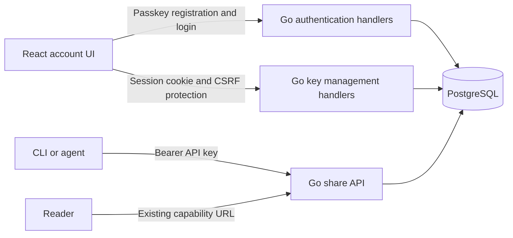

# Passkey login and API key management

## Goal

Remove server-configured `MORSEL_API_KEY` and `MORSEL_API_KEY_FILE`. Let the operator open the Morsel web UI, sign in with a passkey, and create, list, and revoke database-backed API keys. Keep capability share URLs public and unchanged.

Status: implementation and local validation complete; pull request delivery is in progress. The initial release permits only the first account to register. Invitations remain deferred. Production deployment, owner enrollment, client key replacement, and obsolete GitHub secret removal remain open operator handoff tasks; the full plan is not complete.

## Context

- `api/internal/auth/auth.go` checks a static list of configured keys. All keys have administrator access.
- `api/internal/config/config.go` requires at least one key at startup.
- `api/internal/share/repository.go` has no user ownership checks. Any valid key can revoke any share.
- `packages/viewer/` is an existing React app served by Go from the API origin. Extend it; do not add another frontend service.
- `compose.yaml`, `.env.example`, and `.github/workflows/deploy.yml` configure the server key.
- The production origin is `https://morsel.narumi.dev`. HTTPS is already available; certificate provisioning and reverse proxy setup are outside this plan.
- CLI scripts and the TypeScript client use Bearer authentication. Their callers can still keep a UI-created key in a client-side environment variable named `MORSEL_API_KEY`. Removing server configuration does not require renaming client configuration.

## Registration policy

- In the initial release, only the first account can register. It becomes the owner, with multiple passkeys and API keys.
- After owner registration, reject all attempts to create another account through the registration API. Hiding the registration UI is not sufficient.
- Protect initial registration with a one-time operator setup token so an arbitrary visitor cannot claim the instance first.
- Serialize initial registration with a PostgreSQL transaction lock and reject registration when the owner already exists. Concurrent requests must not create multiple accounts. Do not impose a global one-row constraint on the users table.
- Preserve current administrator permissions: all owner-issued API keys can create and revoke shares, including existing shares. No share ownership migration is required.
- Account invitations, public registration, roles, and per-user share permissions are outside this release.

### Possible later release: invitations

- Use a normal users table with stable user IDs now. Associate passkey credentials and API keys with those IDs, as required by the current authentication design.
- Do not implement invitation endpoints, invitation storage, extra roles, or feature flags now.
- A later release can add owner-issued, expiring, single-use invitations without reopening public registration. Invitees register their own passkeys and manage their own keys.
- Before enabling invitations, define share permissions and migrate existing shares as required. Current API keys have administrator access; issuing keys to another user without authorization changes would let that user revoke any share.

## Architecture

### Authentication boundaries

- Use a maintained Go WebAuthn library, with `github.com/go-webauthn/webauthn` as the first candidate. Verify supported Go versions and current security guidance before selecting a version. Do not implement WebAuthn verification directly.
- Derive the relying party ID from `MORSEL_URL` using only its hostname, without a scheme, port, or path. Derive the allowed origin from its scheme and host, including a non-default port. Production uses RP ID `morsel.narumi.dev` and allowed origin `https://morsel.narumi.dev`. Do not trust the request Host header to configure either value. Test hostname-only RP ID derivation and exact origin validation, including wrong-port rejection.
- Require discoverable credentials and user verification for passkey registration and login. Use username-free login for the owner.
- Store credentials, expiring single-use WebAuthn flows, and sessions in PostgreSQL. Bind each flow to its initiating browser and operation. Consume it atomically and follow the library's backup-aware signature-counter policy.
- Store an authentication generation on the account. Bind account authentication flows, sessions, recovery grants, and fresh-verification grants to that generation. Login completion and session-authorized mutations must lock the account row and recheck the generation and applicable authorization records within their completion transaction. Authorization checked only at request entry is insufficient.
- Use opaque random session tokens. Store only their hashes. Set a host-only `HttpOnly`, `Secure`, `SameSite=Lax` cookie in production. Permit non-Secure cookies only for supported localhost HTTP development.
- Use explicit session expiry, server-side logout, and fresh passkey verification for key creation, key revocation, and passkey changes. Set fixed lifetime values during implementation; do not add configuration flags without a demonstrated need.
- Protect cookie-authenticated mutations with exact Origin checks and session-bound CSRF tokens. Keep GET requests read-only and CORS disabled.
- Allow only browser sessions to manage API keys and passkeys. API keys cannot mint keys, register credentials, or manage sessions. Keep share write endpoints Bearer-only for this scope.
- Return `Cache-Control: no-store` for authentication and management responses. Never log cookies, setup tokens, WebAuthn payloads, or raw API keys. Bound authentication request sizes and rate-limit authentication and setup attempts. Do not trust arbitrary forwarded client IP headers.

### Setup and recovery

- Add an operator command to create a short-lived, one-use setup token. Store its hash and show the raw token only in the command output. Pass it to the UI as a form value, not as a URL query or path.
- Require the setup token to register the owner. Atomically create the owner and first credential, consume the token, and close initial setup. Concurrent setup requests must create at most one owner.
- An unconfigured instance serves health checks and the setup UI, but rejects privileged share operations. It must never permit unauthenticated writes.
- Let the owner register a backup passkey and remove a passkey, but reject removal of the last credential. Serialize credential additions, removals, and recovery completion with a lock on the same account row. Count remaining credentials and perform deletion within that transaction. Test simultaneous deletion of two remaining passkeys: exactly one deletion may succeed, and one usable credential must remain.
- Provide an explicit operator recovery command that authorizes one replacement credential. Recovery completion must atomically lock the account row, verify and consume the recovery grant, replace the credentials, advance the authentication generation, and invalidate old sessions, pending WebAuthn flows, fresh-verification grants, and other recovery grants. An old request that commits before recovery has its authorization invalidated by recovery; one that attempts to commit afterward must fail the generation or authorization check. Test pending login, passkey registration, and session-authorized key creation racing with recovery, and reject replay of the recovery grant.
- Document API key revocation after suspected compromise. Recovery does not automatically revoke existing API keys; operators must review and revoke them separately. Recovery must not require deleting shares or resetting the database.
- Package operator commands in the distroless image so setup and recovery work through non-interactive `docker compose run` commands.

### API keys

- Generate at least 256 random bits on the server. Store only a SHA-256 hash plus key ID, owner ID, user-supplied name, safe display prefix, creation time, and revocation time.
- Return the raw key only in the creation response. The UI shows it once with a copy action and a warning that it cannot be recovered. Do not store it in browser storage.
- List metadata without raw keys or hashes. Revoke by key ID with an idempotent operation. Validate active keys against PostgreSQL on each privileged request; do not add an authentication cache.
- Revocation blocks subsequent requests but cannot cancel an already-authorized operation. Revoking an API key does not revoke shares created with it.
- Keep existing share request and response formats and Bearer headers. Existing environment-configured keys stop working at cutover; all clients must receive replacement keys.

### UI and contract

- Use the existing app for setup, passkey login, key management, passkey management, and logout. Keep share and Gist routes unchanged.
- Specify authentication, session, passkey, and key management routes in `api/openapi.yaml`, under `/v1/`, with explicit authentication requirements. Keep the public TypeScript share client focused on share operations.
- Update Go shell serving and React route parsing for each new account page. Avoid a catch-all that hides missing API routes or assets.
- Use browser WebAuthn APIs with a small maintained browser helper if serialization requires it. Do not introduce a frontend authentication service.

### Local development and browser test configuration

- For interactive development, configure Go with `MORSEL_ENVIRONMENT=development`, `MORSEL_URL=http://localhost:5173`, and its existing listen port `12647`. Start Vite with `npm run dev --workspace @narumitw/morsel-viewer -- --host localhost --port 5173 --strictPort`.
- Open only `http://localhost:5173`. Its RP ID is `localhost`; its allowed origin is `http://localhost:5173`. Keep the existing Vite `/v1` proxy to `http://127.0.0.1:12647`. Browser API requests use relative paths, so cookies and Origin checks use the browser origin without enabling CORS. Do not mix `localhost` and `127.0.0.1` in browser URLs.
- For real-backend browser tests, build the viewer and let Go serve it at `http://localhost:12647`, with matching `MORSEL_URL`. Its RP ID is `localhost`; its allowed origin is `http://localhost:12647`. Test direct navigation and refresh through Go rather than the Vite preview server.
- Add a separate Playwright configuration and test directory for authentication integration tests. Keep them separate from the existing mocked viewer suite. Add the root command `npm run test:auth:browser` to start the built Go service against a disposable test database, apply migrations, run the authentication tests, and stop the service on success or failure.
- Add a required authentication browser job to `.github/workflows/ci.yml` with PostgreSQL, Go, Node.js, and Chromium. Build the viewer and backend, then run `npm run test:auth:browser`. The job must fail if the backend or database is unavailable, no authentication tests execute, or a required authentication test is skipped. It must not depend on the opt-in `MORSEL_E2E_LIVE` suite.

## Plan

- [x] Confirm initial single-owner registration. Evidence: user selected “1. only the first user,” then requested the possibility of future invitations. Keep public registration closed after setup, preserve current share permissions, and avoid a global one-user schema constraint.
- [x] Specify API contracts and add additive PostgreSQL migrations for owner, authentication generation, credentials, setup/recovery grants, WebAuthn flows, sessions, and API keys. Add expiry indexes and bounded cleanup for temporary records. Evidence: OpenAPI lint and generated-code checks pass; migrations pass up/down/up and upgrade tests against existing share data.
- [x] Implement setup/recovery commands, passkey verification, session handling, CSRF checks, and authentication rate limits. Evidence: unit and PostgreSQL tests reject invalid origins, RP IDs, expired/replayed flows, missing user verification, invalid setup grants, concurrent owner claims, and expired/revoked sessions. Tests verify hostname-only RP IDs, exact localhost origins, recovery races with pending authentication and management requests, recovery grant replay rejection, and concurrent last-passkey deletion protection.
- [x] Replace static key validation with database-backed Bearer authentication and session-only key management. Evidence: raw keys are returned once and absent from database records, lists, and logs; revoked and unknown keys fail; API keys cannot call account management endpoints; public capability reads still work. Database failures fail closed without reporting successful authentication.
- [x] Add the account pages to `packages/viewer/`, including loading, cancellation, unsupported-browser, expired-session, and error states. Evidence: component tests and browser tests cover setup, login, backup passkey, key creation, key revocation, and logout. Run a real Go/PostgreSQL browser flow with a virtual WebAuthn authenticator; include refresh and direct-route navigation.
- [ ] Add the isolated authentication browser suite, `npm run test:auth:browser`, and the required CI job described above. Evidence: a CI run provisions PostgreSQL, starts Go with the built viewer, completes setup and passkey login with a virtual authenticator, creates a key, uses it to create a share, revokes it, confirms it is rejected, and logs out. Missing infrastructure, zero executed tests, or skipped required tests fail the job.
- [x] Integrate the release: remove static key loading and server wiring; remove the key from Compose, `.env.example`, and `deploy.yml`; package operator commands; update configuration tests, README, deployment, design, usage, and client onboarding instructions. Keep client-side key configuration supported. Evidence: production image starts without either server key variable; setup and recovery work in the image; a UI-created key works with the existing TypeScript client and CLI scripts.
- [ ] Blocked — human production handoff required: validate and deploy the complete API and UI together. Back up PostgreSQL, test the migration on a restored database, enroll the owner, create replacement client keys, and update clients. Delete the obsolete GitHub secret after successful validation. Evidence: production login succeeds at the configured HTTPS origin, replacement clients create/revoke shares, revoked keys fail, and existing share URLs remain usable.

## Rollback / Recovery

- Keep a tested database backup and the previous immutable image before migration. Coordinate the client key transition; do not keep a permanent legacy authentication path.
- Prefer a corrective migration and roll forward after new accounts or keys exist.
- The existing migration runner rejects unknown migration versions. Do not assume an older image can start its migration service against the upgraded schema, even when schema changes are additive.
- Test any required downgrade on a restored copy first. Reverting authentication also requires the previous server key and matching client configuration. Database restoration discards later writes; stop writes and reconcile them before recovery.
- Preserve the configured hostname. Changing the WebAuthn RP ID can make stored passkeys unusable; plan credential re-enrollment before a domain change.

## Verification evidence

- Go 1.27.3: `go generate ./...`, `go vet ./...`, `go mod verify`, and all PostgreSQL-backed `go test -race ./...` checks pass. Authentication coverage is 83.4%. Authentication concurrency tests pass with `-count=10`; the share final-view concurrency test also passes with `-count=10`.
- `npm run ci` passes: 171 viewer tests, 9 client tests, OpenAPI lint, TypeScript checks, formatting, and production build.
- `npm run test:browser` passes 14 existing browser tests; the existing opt-in live test remains skipped. The separate required authentication suite runs without skips.
- `npm run test:auth:browser` passes all seven lifecycle steps against Go and an isolated PostgreSQL database, including TypeScript and Python client compatibility. The same suite passes against the built non-root container image, using its packaged `account` executable for setup and recovery.
- The full authentication suite also passes through the real Vite `/v1` proxy at `http://localhost:5173`, with Go on port 12647 inside an isolated container. The running production service was not accessed.
- All 28 Python skill tests pass. Production dependency audit reports no vulnerabilities. `govulncheck` reports no reachable vulnerabilities with Go 1.27.3; Docker now uses that patched version for GO-2026-6809. The existing Go 1.26.10 CI minimum is also patched.
- A synthetic version-5 database was backed up, restored separately, and upgraded to version 6. Its existing capability remained readable and consumed one view. No production data was used.
- Harness checks reject missing infrastructure, zero tests, skipped required tests, unsafe database names, and database query aliases that would redirect migrations. Signal cleanup leaves no test service or disposable database. Authentication test traces, videos, and screenshots are disabled; output is temporary.
- Review fixes cover slow request bodies before account locks, recovery races, default-port/case origin normalization, per-ceremony rate budgets, test database isolation, and native WebAuthn cancellation on page unmount.
- Production has not been changed. Actual owner passkey enrollment, client secret replacement, GitHub secret removal, and production HTTPS acceptance require the operator. Keep this plan until those tasks and user acceptance are complete.

## Completion Checklist

- [x] Single-owner registration passes concurrent-request tests; second-account creation fails after setup, and initial setup requires a valid operator token.
- [x] Setup, login, backup passkey, recovery, logout, and API key lifecycle pass unit, database, and real-backend browser tests.
- [x] Cross-origin requests, CSRF, challenge replay, credential-management misuse, and API-key access to account management are rejected.
- [x] Recovery race tests prove that old login and credential-add flows and old session-authorized mutations cannot commit after recovery; recovery grants cannot be replayed.
- [x] Concurrent deletion tests leave at least one usable passkey.
- [x] Local development works through Vite with RP ID `localhost` and origin `http://localhost:5173`; origin ports never appear in RP IDs, and wrong-port origins are rejected.
- [x] `cd api && go generate ./... && go vet ./... && go test -race ./...` passes with `MORSEL_TEST_DATABASE_URL` set; generated files have no unexpected drift.
- [x] `npm run ci` and `npm run test:browser` pass; existing share, preview, Instant View, Gist, and client tests remain green.
- [ ] `npm run test:auth:browser` passes in the required CI job against Go and PostgreSQL, with all required tests executed and no skips.
- [x] A built production image starts without server API key configuration and supports operator setup/recovery commands.
- [ ] Blocked — production operator must complete client cutover and HTTPS passkey checks, then remove the obsolete GitHub secret. Local migration and restored-data checks pass.
- [ ] User accepts the implementation and release. Delete this plan only after all tasks and checks pass.
